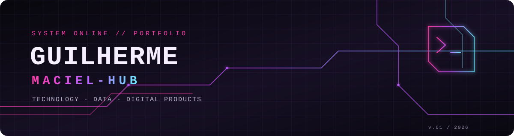

 

  

<a href="#portugues">🇧🇷 Português</a> · <a href="#english">🇺🇸 English</a>

---

## 🇧🇷 Olá, eu sou o Guilherme!

**Tecnologia, dados e produtos digitais — transformando problemas reais em soluções práticas.**

Sou formado em **Análise e Desenvolvimento de Sistemas (ADS)** e atuo com tecnologia, suporte a sistemas e processos de negócio. Minha experiência inclui desenvolvimento e testes, SQL, documentação técnica, integrações e rotinas de versionamento. Também estou retomando os estudos de programação e explorando formas modernas de construir aplicações.

- 🔭 **Construindo:** projetos pessoais e aplicações com foco em utilidade real.
- 🌱 **Estudando:** programação, desenvolvimento web e boas práticas de engenharia.
- 🧩 **Experiência:** suporte a sistemas, SQL/PLSQL, testes, documentação e processos de entrega.
- 🎯 **Objetivo:** evoluir como profissional de tecnologia e desenvolver produtos digitais úteis.
- ⚡ **Interesses:** automação, dados, integrações, UX e ferramentas que simplificam o dia a dia.

## 🧪 Projetos em destaque

<table>
  <tr>
    <td width="50%" valign="top">
      <h3>🐷 Porquinho Financeiro</h3>
      Aplicação pessoal de organização financeira, com foco em acompanhar lançamentos, contas, dívidas e objetivos em uma experiência simples e mobile-first.
        
      
       
      Projeto em evolução · Supabase · PWA
    </td>
    <td width="50%" valign="top">
      <h3>🚀 Outros projetos</h3>
      Aplicações, automações e experimentos serão destacados aqui conforme forem publicados.
        
      
       
      Veja todos os projetos no meu GitHub.
    </td>
  </tr>
</table>

## 🛠️ Tecnologias e ferramentas

**Dados & Banco de Dados**

**Desenvolvimento & Entrega**

**Plataformas & Ferramentas**

Lista baseada nas ferramentas com as quais já tive contato. Vou atualizá-la conforme aprofundar meus estudos e publicar novos projetos.

## 📊 GitHub em números

  
  

  

## 🐍 Atividade

A animação das contribuições é gerada automaticamente pelo GitHub Actions deste repositório. Ela pode levar alguns minutos para aparecer após a primeira execução.

  <picture>
    <source media="(prefers-color-scheme: dark)" srcset="https://raw.githubusercontent.com/Maciel-hub/Maciel-hub/output/github-contribution-grid-snake-dark.svg"/>
    <source media="(prefers-color-scheme: light)" srcset="https://raw.githubusercontent.com/Maciel-hub/Maciel-hub/output/github-contribution-grid-snake.svg"/>
    
  </picture>

## 🤝 Vamos nos conectar?

Se você se interessa por tecnologia, desenvolvimento, dados ou construção de produtos digitais, explore meus repositórios e vamos trocar ideias.

  

---

## 🇺🇸 Hi, I'm Guilherme!

**Technology, data, and digital products — turning real-world problems into practical solutions.**

I have a degree in **Systems Analysis and Development** and work with technology, business systems support, and operational processes. My background includes development and testing workflows, SQL, technical documentation, integrations, and release/versioning routines. I'm also getting back into programming and exploring modern ways to build applications.

- 🔭 **Building:** personal projects and useful applications.
- 🌱 **Learning:** programming, web development, and software engineering practices.
- 🧩 **Background:** business systems support, SQL/PLSQL, testing, documentation, and delivery processes.
- 🎯 **Goal:** grow as a technology professional and build useful digital products.
- ⚡ **Interests:** automation, data, integrations, UX, and tools that simplify everyday work.

## 🧪 Featured projects

- **🐷 Porquinho Financeiro** — a personal finance app focused on transactions, accounts, debts, and financial goals, with a mobile-first experience.  
  [Explore the repository](https://github.com/Maciel-hub/porquinho-financeiro)
- **🚀 More projects** — browse my repositories for applications, automations, experiments, and learning projects.  
  [Explore all repositories](https://github.com/Maciel-hub?tab=repositories)

## 🛠️ Tools & technologies

SQL · PL/SQL · Git · Docker · Jenkins · Azure · REST APIs · Supabase · GitHub · Jira · CI/CD

*This list reflects tools I have worked with; I will keep updating it as I deepen my skills and publish more projects.*

## 📈 Current direction

I'm focused on learning by building, improving my development workflow, and creating projects that solve practical problems. I value clear documentation, maintainable solutions, and continuous improvement.

**Thanks for visiting! / Obrigado pela visita!**

