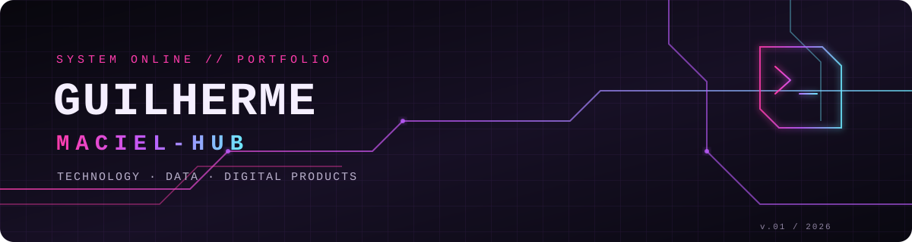

 

  <strong>SOFTWARE · DATA · BUSINESS SYSTEMS</strong> 
  Connecting technology, data and real-world business needs.

  <a href="#sobre-mim">Sobre mim</a> ·
  <a href="#experiencia">Experiência</a> ·
  <a href="#projetos">Projetos</a> ·
  <a href="#stack">Tecnologias</a> ·
  <a href="#english">English</a>

---

## Sobre mim

Sou **Guilherme Maciel**, formado em **Análise e Desenvolvimento de Sistemas**. Minha experiência reúne desenvolvimento de software, análise de dados, sistemas ERP e suporte a soluções de negócio.

Atuei por dois anos como estagiário de desenvolvimento na **TOTVS**, em atividades relacionadas ao produto TOTVS Moda, com contato com versionamento, testes, manutenção, SQL, APIs e processos de integração e entrega contínua. Atualmente, trabalho com sistemas empresariais, investigação de incidentes, integrações e atendimento técnico.

Gosto de compreender o contexto de um problema, investigar sua causa e construir soluções que simplifiquem processos. Estou retomando e aprofundando meus estudos em desenvolvimento por meio de projetos práticos.

- **Formação:** Análise e Desenvolvimento de Sistemas (ADS).
- **Experiência:** desenvolvimento, dados, sistemas ERP, suporte técnico e integrações.
- **Prática técnica:** SQL/PLSQL, APIs, Git, Docker, Jenkins e Azure DevOps.
- **Interesses:** desenvolvimento de aplicações, automação, dados e produtos digitais.

## Experiência & atuação

| Área | Vivência |
|---|---|
| Desenvolvimento de software | Manutenção, testes, versionamento e processos de entrega |
| Dados & bancos | Consultas SQL, PL/SQL e análise de informações |
| Integrações | APIs e comunicação entre sistemas empresariais |
| DevOps & ferramentas | Git, Docker, Jenkins, Azure DevOps e Jira |
| Sistemas de negócio | ERP, análise de incidentes e suporte a operações |

## Projetos em destaque

### 🐷 Porquinho Financeiro

Uma aplicação PWA de organização financeira pessoal, projetada com abordagem mobile-first para acompanhar receitas, despesas, contas, dívidas e metas.

- Interface voltada para uso em dispositivos móveis.
- Organização de lançamentos e acompanhamento financeiro.
- Integração com Supabase e serviços de backend.
- Evolução contínua da experiência e das funcionalidades.

  
  
  
  

**Acessos:** [Abrir demonstração](https://porquinho-financeiro.guilhermekira2015.workers.dev/) · [Ler estudo de caso](projects/porquinho-financeiro.md)

Projeto em evolução. O código-fonte não está público neste momento.

> Priorizo projetos que resolvam problemas reais e documento sua evolução com transparência: decisões, funcionalidades, aprendizados e próximos passos.

## Tecnologias & ferramentas

**Dados & bancos de dados**
 

  

**Desenvolvimento & integração**
 

  

**DevOps & plataformas**
 

Tecnologias e ferramentas com as quais tive contato profissional ou prático. Meu foco é aprofundar conhecimentos por meio de aplicações reais.

## GitHub em números

  
  

  

## Atividade

  <picture>
    <source media="(prefers-color-scheme: dark)" srcset="https://raw.githubusercontent.com/Maciel-hub/Maciel-hub/output/github-contribution-grid-snake-dark.svg" />
    <source media="(prefers-color-scheme: light)" srcset="https://raw.githubusercontent.com/Maciel-hub/Maciel-hub/output/github-contribution-grid-snake.svg" />
    
  </picture>

## Contato

Para conversar sobre desenvolvimento, dados, integrações, automação ou produtos digitais, acesse meus projetos e entre em contato pelo GitHub.

  

---

## English

Hi, I'm **Guilherme Maciel**, a Systems Analysis and Development graduate with experience across software development, data, ERP systems, integrations, and technical support.

I spent two years as a Software Development Intern at **TOTVS**, working with the TOTVS Moda product and gaining hands-on experience with SQL, APIs, testing, maintenance, version control, and software delivery workflows. I currently work with business systems, incident investigation, integrations, and technical support.

I'm strengthening my software development skills through practical projects. My interests include web applications, automation, data, APIs, and digital products.

**Featured project — Porquinho Financeiro:** a mobile-first personal finance PWA for tracking transactions, bills, debts, and financial goals. It is an ongoing project; its source code is not public at this time.

**Tools I've worked with:** SQL, PL/SQL, JavaScript, Git, Docker, Jenkins, Azure DevOps, REST APIs, Supabase, GitHub Actions, and Jira.

*Build with purpose. Learn continuously. Improve iteratively.*

